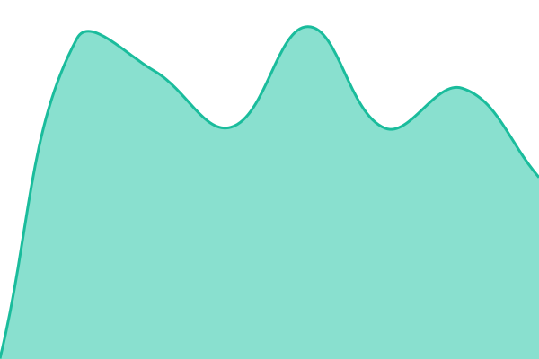

# [📈 Jelenlegi állapot](https://status.ketszeri.hu): <!--live status--> **Minden rendszer működik**

This repository contains the open-source uptime monitor and status page for [Csaba Kétszeri](https://ketszeri.hu), powered by [Upptime](https://github.com/upptime/upptime).

With [Upptime](https://upptime.js.org), you can get your own unlimited and free uptime monitor and status page, powered entirely by a GitHub repository. We use [Issues](https://github.com/ketszeri/reader-friendly-status/issues) as incident reports, [Actions](https://github.com/ketszeri/reader-friendly-status/actions) as uptime monitors, and [Pages](https://status.ketszeri.hu) for the status page.

## [📈 Live Status](https://demo.upptime.js.org): <!--live status--> **Minden rendszer működik**

<!--start: status pages-->
<!-- This summary is generated by Upptime (https://github.com/upptime/upptime) -->
<!-- Do not edit this manually, your changes will be overwritten -->
<!-- prettier-ignore -->
| Cím | Állapot | Előzmények | Válaszidő | Rendelkezésre állás |
| --- | ------ | ------- | ------------- | ------ |
|  [Reader Friendly szolgáltatás](https://reader.ketszeri.hu/health) | Működik | [szolgaltatas.yml](https://github.com/ketszeri/reader-friendly-status/commits/HEAD/history/szolgaltatas.yml) | 

 888ms
     
 | 

<a href="https://status.ketszeri.hu/history/szolgaltatas">100.00%</a>
    

|  [Reader Friendly weboldal](https://reader.ketszeri.hu/) | Működik | [weboldal.yml](https://github.com/ketszeri/reader-friendly-status/commits/HEAD/history/weboldal.yml) | 

 561ms
     
 | 

<a href="https://status.ketszeri.hu/history/weboldal">100.00%</a>
    

<!--end: status pages-->

[**Visit our status website →**](https://status.ketszeri.hu)

## 📄 License

- Powered by: [Upptime](https://github.com/upptime/upptime)
- Code: [MIT](./LICENSE) © [Anand Chowdhary](https://anandchowdhary.com)
- Data in the `./history` directory: [Open Database License](https://opendatacommons.org/licenses/odbl/1-0/)
